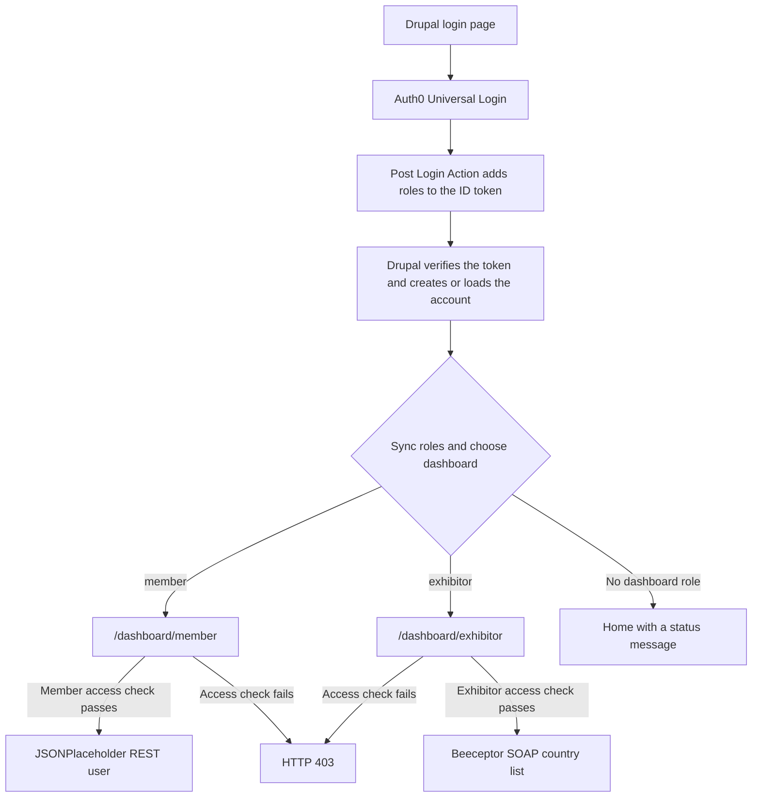

# Drupal Auth0 SSO Assessment

A Drupal 11 prototype with Auth0 sign-in, role-based dashboard access, and
server-side REST and SOAP integrations. See the [module plan](module-plan.md)
and [AI development log](agent-logs.md).

## Architecture



Drupal checks the required role on every dashboard request, including direct
visits. It caches validated public API results for 60 seconds and renders the
current user's identity on each response. The APIs use HTTPS and require no
credentials.

## Environment and dependencies

Install Git, Docker, and [DDEV](https://ddev.com/get-started/).

| Component | Version |
| --- | --- |
| Drupal core | 11.4.13 |
| PHP and database in DDEV | PHP 8.4 and MariaDB 11.8 |
| Drush | 13.8.1 |
| OpenID Connect | 3.x at commit `acc27bd` |
| External Auth | 2.0.15, installed through OpenID Connect |

Composer restores the exact dependency versions from `composer.lock`.

## Setup and run

```sh
git clone https://github.com/yusuf-khan/drupal-assessment.git
cd drupal-assessment
ddev start
ddev composer install
ddev launch
```

In the browser installer, choose **Standard** and create a local
administrator. Then enable the module from the repository root.

```sh
ddev drush en sso_dashboards -y
```

The site opens at `https://drupal-assessment.ddev.site`. The module creates
the `member` and `exhibitor` roles if they are missing. Use `ddev describe`
to confirm the site URL.

## Module evaluation

- **OpenID Connect** powers the current implementation. Its Generic client
  supports Auth0, account provisioning, login hooks, and provider logout. The
  pinned revision supports strict ID-token validation for role assignments.
- **Drupal OIDC Client** was evaluated for its signed-token validation and
  realm management. OpenID Connect’s authorization hooks and login destination
  API fit the dashboard flow.
- **miniOrange SAML SP** is the target for a separate pilot. Its Composer
  edition passed an isolated Drupal 11 install check. The assessment install
  uses OpenID Connect. Mapping assertion roles per user and SAML Single Logout
  require the licensed miniOrange edition.
  [miniOrange plan comparison](https://plugins.miniorange.com/drupal-saml-single-sign-on-sso#pricing)

## Auth0 and test users

1. Create an Auth0 **Regular Web Application** with a database connection,
   Authorization Code grant, and RS256 signing.
2. Add `https://drupal-assessment.ddev.site/openid-connect/auth0` to **Allowed
   Callback URLs** and `https://drupal-assessment.ddev.site/user/login` to
   **Allowed Logout URLs**. Use your site's origin if it differs. Enable
   RP-Initiated Logout discovery if the tenant omits `end_session_endpoint`.
3. Create two test users with distinct email addresses. Assign `member` to
   one and `exhibitor` to the other. Use emails that do not already belong to
   local Drupal accounts.
4. Create an Auth0 **Post Login** Action from
   [post-login-roles.js](auth0/post-login-roles.js). Replace the client ID
   placeholder, click **Deploy**, attach the Action under **Actions →
   Triggers → Post Login**, and click **Apply**.

If your Auth0 plan does not expose role assignments, use administrator-managed
`app_metadata` with `{"roles":["member"]}` and `{"roles":["exhibitor"]}`.
Set the Action's role source to `const roles = event.user.app_metadata?.roles;`.
Both sources use the same Drupal mapping. [Auth0 plans](https://auth0.com/pricing)

Copy `settings.local.php.example` to `web/sites/default/settings.local.php`
on a fresh clone, then uncomment the local settings include in
`web/sites/default/settings.php`. Supply `AUTH0_DOMAIN`, `AUTH0_CLIENT_ID`,
and `AUTH0_CLIENT_SECRET` through the PHP process environment or fill the
fallback values in the ignored local file. Use the tenant hostname without
`https://` or a trailing slash. Keep local credentials out of Git.

Run these commands once on a fresh installation. They create the Drupal
client, enable first-login provisioning and logout, and keep automatic
email-based linking disabled.

```sh
ddev drush php:eval '\Drupal\openid_connect\Entity\OpenIDConnectClientEntity::create(["id" => "auth0", "label" => "Auth0", "plugin" => "generic", "status" => TRUE])->save();'
ddev drush config:set user.settings register admin_only -y
ddev drush config:set openid_connect.settings override_registration_settings true --input-format=yaml -y
ddev drush config:set openid_connect.settings connect_existing_users false --input-format=yaml -y
ddev drush config:set openid_connect.settings end_session_enabled true --input-format=yaml -y
ddev drush config:set openid_connect.settings redirect_logout /user/login -y
ddev drush cr
```

Open `/user/login` in a private window and choose **Auth0** below the local
form. Sign in as each user in turn. Visit the other role’s route directly
and verify HTTP 403. Use **Log out** to end the Drupal and Auth0 sessions.

## Role mapping and dashboards

External Auth links the Auth0 subject to its Drupal account. After each
successful login, the dashboard module reads the verified
`https://sso-prototype.example/roles` ID-token claim. It adds matching
dashboard roles and removes managed roles that are no longer assigned.
Unrelated Drupal roles are preserved.

| Drupal role | Destination | Live data |
| --- | --- | --- |
| `member` | `/dashboard/member` | JSONPlaceholder sample user's name, email, and company |
| `exhibitor` | `/dashboard/exhibitor` | Beeceptor SOAP country names and ISO codes |

With both roles, the default destination is the exhibitor dashboard.
Without a dashboard role, Drupal redirects home with a status message.
Configure role aliases, priority, or cache lifetime in
[`sso_dashboards.settings`](web/modules/custom/sso_dashboards/config/install/sso_dashboards.settings.yml).
For example, accept both `member` and `Customer` from Auth0 with:

```sh
ddev drush config:set sso_dashboards.settings role_mapping.member '[member, Customer]' --input-format=yaml -y
```

### Preview without Auth0

Run these commands once to create local demo accounts and print one-time links.
Open the two links in separate browser sessions.

```sh
ddev drush user:create assessment_member --mail=member@example.test
ddev drush user:role:add member assessment_member
ddev drush user:create assessment_exhibitor --mail=exhibitor@example.test
ddev drush user:role:add exhibitor assessment_exhibitor
ddev drush user:login --name=assessment_member --no-browser dashboard/member
ddev drush user:login --name=assessment_exhibitor --no-browser dashboard/exhibitor
```

## Validation results

The DDEV suite passed **12 tests with 86 assertions**. The browser test
installs a fresh Drupal Standard site and enables the assessment module.
The tests cover account provisioning, role reconciliation, redirects,
access checks, caching, and API failure handling with fixtures. PHPUnit
reported four deprecations from External Auth and its Views configuration.

```sh
ddev exec env SIMPLETEST_BASE_URL=http://localhost \
  SIMPLETEST_DB=mysql://db:db@db/db BROWSERTEST_OUTPUT_DIRECTORY=/tmp \
  vendor/bin/phpunit -c web/core web/modules/custom/sso_dashboards/tests/src
```

| Check | Result |
| --- | --- |
| Live Auth0 member | Assigned `member`, redirected to the member dashboard, HTTP 200 for member and 403 for exhibitor |
| Live Auth0 logout | Ended both sessions. Both dashboards returned 403, and Auth0 prompted for credentials at the next login. |
| Live APIs | REST returned Leanne Graham’s sample record. SOAP returned 246 countries. |
| Direct URL access | Browser tests verified 403 for wrong-role and anonymous requests. |

The screenshots use local Drupal demo accounts and live API data.
[Member dashboard](screenshots/member-dashboard.png) ·
[Exhibitor dashboard](screenshots/exhibitor-dashboard.png) ·
[Member denied exhibitor](screenshots/member-exhibitor-denied.png) ·
[Exhibitor denied member](screenshots/exhibitor-member-denied.png) ·
[Anonymous denied](screenshots/anonymous-member-denied.png)

## Challenges and blockers

- **Missing roles after sign-in.** The Auth0 Action was deployed but missing
  from the Post Login flow. Applying the binding restored the role claim.
- **Local database recovery.** An earlier prototype left stale module
  registrations and a missing External Auth table. The local database was
  repaired. Fresh installs create the required schema automatically.
- **Pending live checks.** The linked exhibitor account has the correct
  Drupal role. A fresh exhibitor sign-in and logout replay and a live role
  revocation check remain pending.
- **SAML cutover.** The miniOrange target requires the licensed edition and
  a separate Auth0 SAML application. The live prototype uses OpenID Connect.
  The [SAML Post Login Action](auth0/post-login-saml-roles.js) and
  [cutover plan](module-plan.md#10-miniorange-saml-pilot-with-auth0) are
  available for that evaluation.
